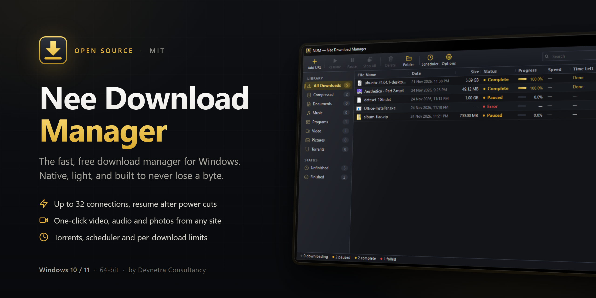
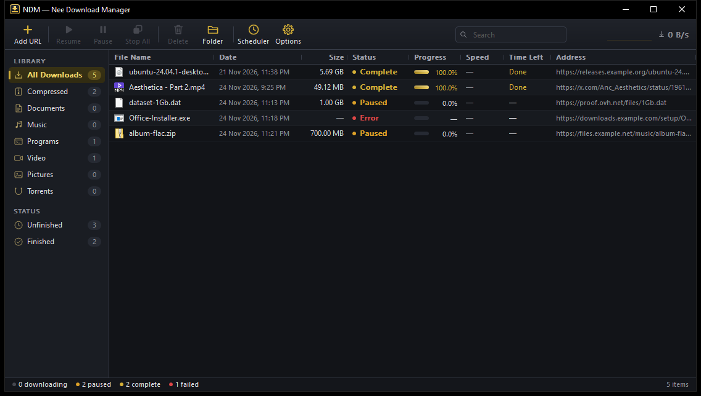
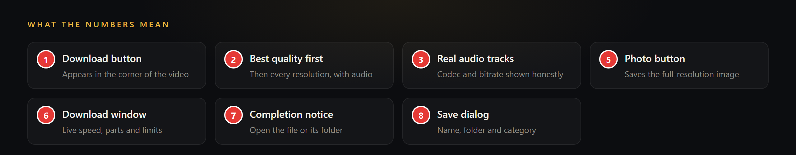
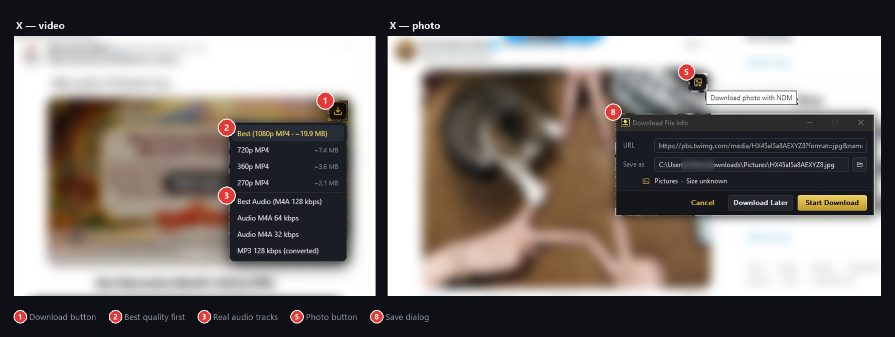
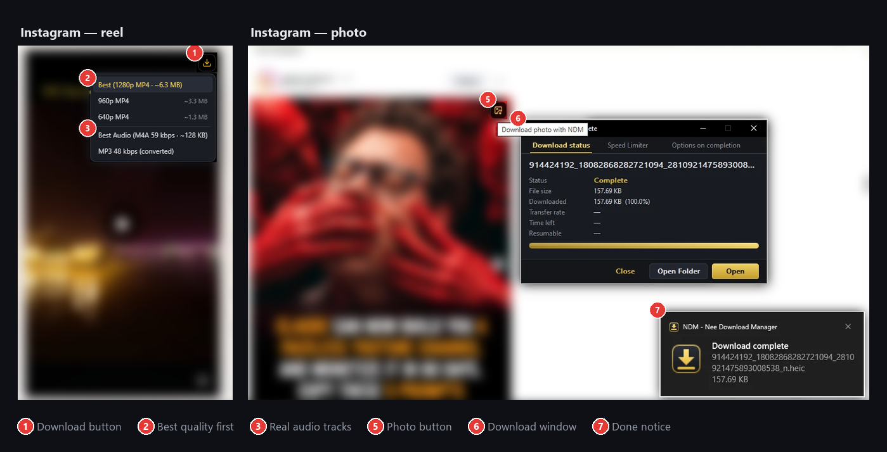
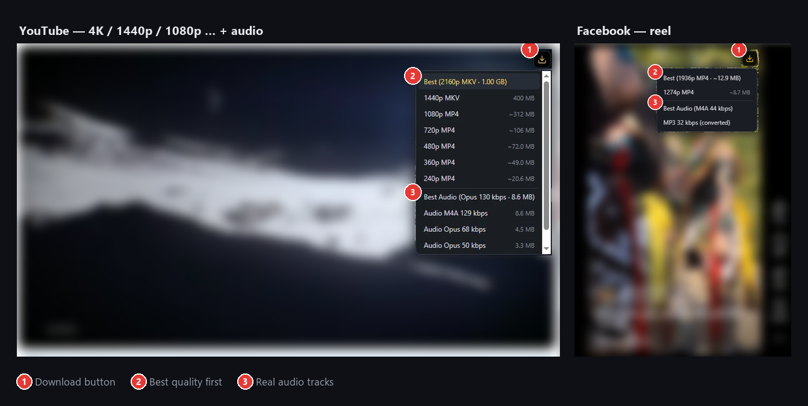
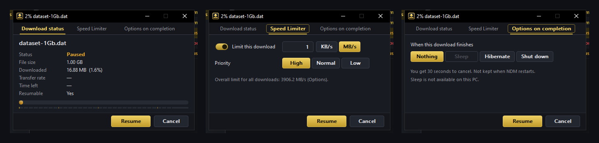
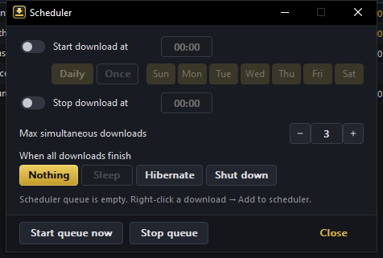
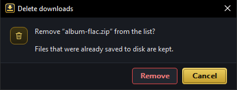

<div align="center">



# Nee Download Manager (NDM)

**A fast, free and open-source download manager for Windows — multi-connection downloads,
one-click video / audio / photo saving from almost any site, torrents and a real scheduler.
No ads, no trial, no account.**

[](https://github.com/DevnetraConsultancy/nee-download-manager/releases/latest)
[](https://github.com/DevnetraConsultancy/nee-download-manager/releases)
[](https://github.com/DevnetraConsultancy/nee-download-manager/actions/workflows/ci.yml)
[](LICENSE)
[](#install)
[](#build-from-source)
[](https://github.com/DevnetraConsultancy/nee-download-manager/stargazers)

[**Download NDM 1.0.5**](https://github.com/DevnetraConsultancy/nee-download-manager/releases/latest) ·
[Features](#features) · [Screenshots](#screenshots) · [Compared with IDM](#compared-with-idm) ·
[Install](#install) · [Build](#build-from-source) · [FAQ](#faq)

</div>

---

## Why NDM

NDM does what a premium download manager does — splits every download over many
connections, catches downloads from your browser, puts a small download button on
videos, resumes after crashes and power cuts — and it is **free and MIT-licensed**.
The whole code base is here: a native C++17 / Win32 app, a Chrome / Edge / Firefox
extension and an offline installer.

Everything NDM shows is real. The quality list comes from the site itself, the audio
list shows the actual codec and bitrate of each track, sizes marked `~` are estimates
and unknown sizes stay blank. Nothing is invented to look good.

## Features

<table>
<tr>
<td width="50%" valign="top">

###  Fast, safe downloads
- Up to 32 connections per file (8 by default) with **dynamic segmentation** (idle connections take over the slowest part)
- Pause / resume, resume after restart, **resume after a power cut** (parts are flushed before progress is saved)
- **Refresh download address** — paste a new link for an expired one and continue where you stopped
- If a server changes the file, NDM notices (size, ETag, Last-Modified) instead of joining two versions
- One refused connection never fails the whole download; automatic retry with back-off
- Auto-resume when the network comes back or the PC wakes up

</td>
<td width="50%" valign="top">

###  Video, audio and photos
- A small download button in the corner of videos on **YouTube, X, Instagram, Facebook, Reddit, TikTok** and most other sites
- **Best** quality first (up to 4K / 8K), then every resolution — video and audio merged into one file
- **Real audio list**: *Best Audio (Opus 160 kbps)*, the site's other tracks, and honest MP3 conversions marked *(converted)*
- Photos in full resolution (Instagram, X `orig`, Pinterest, Reddit)
- Multi-video X posts: the clicked video is the one you get

</td>
</tr>
<tr>
<td valign="top">

###  Browser integration
- Chrome, Edge and Firefox extension: downloads are handed to NDM with cookies and referrer, so signed-in downloads work
- *Download with NDM* and *Download all links* in the right-click menu
- Leaves the browser alone when NDM is closed, for form (POST) results and in private windows
- Clipboard watching and drag-and-drop of links and `.torrent` files

</td>
<td valign="top">

###  Control
- **Per-download speed limit** and **priority** (High / Normal / Low), changeable while downloading
- Global speed limit from the tray in one click
- **Scheduler**: start and stop times, days of the week, one-off dates, max simultaneous downloads
- When done: Sleep, Hibernate or Shut down — with a 30-second cancel window
- Queue order, search, Date column, categories

</td>
</tr>
<tr>
<td valign="top">

###  Torrents
- Magnet links and `.torrent` files (aria2 engine), with file selection
- Live speed limits, resume from the cached torrent even if the original link is gone

</td>
<td valign="top">

###  Privacy and security
- No telemetry, no ads, no account
- Mark-of-the-Web on every file, so Windows SmartScreen checks downloads
- Cookies stored encrypted with Windows DPAPI; the browser bridge is a per-user pipe locked to your account
- Never overwrites a file without asking

</td>
</tr>
</table>

## Screenshots

> Site content behind NDM's controls is blurred on purpose. The red numbers point at NDM's own controls.

<table>
<tr><td align="center"><br><sub>Main window — categories, Date column, live status bar</sub></td></tr>
</table>



**X (Twitter) — video and photo**


**Instagram — reel and photo**


**YouTube (up to 4K) and Facebook reels**


<table>
<tr>
<td width="60%"><br><sub>Download window: status, per-download Speed Limiter, Options on completion</sub></td>
<td width="40%"><br><sub>Scheduler</sub><br><br><br><sub>Every dialog follows the dark theme</sub></td>
</tr>
</table>

## Compared with IDM

Internet Download Manager is the best-known download manager on Windows. Here is a
factual, feature-by-feature comparison. If you spot an error, please open an issue.

| | NDM | IDM |
|---|:---:|:---:|
| Price |  Free | Paid licence (trial first) |
| Source code |  Open (MIT) |  Closed |
| Ads, trial or registration prompts |  None |  Trial / registration prompts |
| Multi-connection downloads, dynamic segmentation |  |  |
| Browser capture (Chrome, Edge, Firefox) |  |  |
| Video download button with quality list |  |  |
| Audio list with real codec and bitrate |  |  Limited |
| Full-resolution photo button |  |  Limited |
| BitTorrent and magnet links |  Built in |  |
| Per-download speed limit |  |  |
| Download priority (High / Normal / Low) |  |  Queue order only |
| Scheduler and shut down when done |  |  |
| Refresh an expired download address |  |  |
| Power-cut-safe resume (flushed parts, list backup) |  |  Not documented |
| Code you can audit and build yourself |  |  |
| Signed installer |  Not yet |  |
| Firefox add-on that stays installed |  Temporary for now |  |
| Site grabber (crawl a whole site) |  Page links only |  |

<sub>IDM and Internet Download Manager are trademarks of Tonec Inc. NDM is an independent
project and is not affiliated with, endorsed by or derived from Tonec Inc. or IDM.
Comparison made in November 2026 from public information; corrections are welcome.</sub>

## Pros and cons

<table>
<tr>
<td width="50%" valign="top">

** Pros**
- Free and open source under MIT — use it at work, fork it, ship it
- Native C++ / Win32: small memory use, starts instantly
- Video, audio, photos, files and torrents in one app
- Honest quality and audio lists, real sizes
- Careful with your data: power-cut-safe, never overwrites silently
- One offline installer, nothing downloaded during setup

</td>
<td width="50%" valign="top">

** Cons (today)**
- Windows only (10 / 11, 64-bit)
- Installer not code-signed yet, so SmartScreen warns on first run
- Browser extension is loaded unpacked; on Firefox it is temporary until it is signed by Mozilla
- Installer is about 120 MB because it bundles FFmpeg, yt-dlp, Deno and aria2
- Video sites change often; NDM keeps yt-dlp up to date, but a site can break for a short time

</td>
</tr>
</table>

## Install

1. Download **`NDM-1.0.5-x64-Setup.exe`** from the [latest release](https://github.com/DevnetraConsultancy/nee-download-manager/releases/latest) and run it. It installs offline to `C:\Program Files\Devnetra\NDM` and shows up in *Apps & features* (also in tools such as Revo Uninstaller).
   SmartScreen may say *Windows protected your PC* because the installer is not signed yet: choose **More info → Run anyway**. You can check the file against the SHA-256 on the release page.
2. On first start NDM asks whether to start with Windows and to capture browser downloads.

### Add the browser extension

| Browser | Steps |
|---|---|
| Chrome / Edge | Open `chrome://extensions` (or `edge://extensions`), turn on **Developer mode**, then drag `C:\Program Files\Devnetra\NDM\ext\chrome` onto the page (or **Load unpacked**). |
| Firefox | `about:debugging` → **This Firefox** → **Load Temporary Add-on** → `C:\Program Files\Devnetra\NDM\ext\firefox\manifest.json`. Firefox removes temporary add-ons when it closes; load it again after a restart. |

### Uninstall

*Apps & features* → NDM → Uninstall. You are asked whether to remove your download list and settings too; downloaded files are never touched. Silent uninstall: `Uninstall.exe /S` (add `/removedata` to remove settings as well).

## Build from source

Requirements: Visual Studio 2022 Build Tools (C++ x64), CMake 3.20+, Ninja, PowerShell 5.1, Python 3 and Node.js for the tests.

```powershell
# third-party tools (pinned versions, SHA-256 verified)
powershell -ExecutionPolicy Bypass -File tools\fetch_tools.ps1
powershell -ExecutionPolicy Bypass -File tools\fetch_aria2.ps1

# full build + offline installer -> dist\NDM-1.0.5-x64-Setup.exe
build_sfx.bat

# developer build only (no installer)
tools\dev_build.bat build_dev
```

Set `NDM_SIGN_CERT` (and optionally `NDM_SIGN_TIMESTAMP`) to code-sign the installer.

### Tests

More than 450 automated checks run on every push ([CI](.github/workflows/ci.yml)); see [`tests/README.md`](tests/README.md).

| Suite | What it covers |
|---|---|
| Engine fault tests | A local server that breaks on purpose: dropped ranges, changed files, CDN ETags, refused connections, speed limits and priorities measured on the wire |
| Queue | Power-cut recovery of the download list, scheduler maths, refresh address, auto-retry |
| Extension | Capture rules, cookies (SameSite), media button, quality and audio lists, Chrome and Firefox copies |
| UI logic, uninstaller, loopback server | Dialog rules, settings round-trips, safe data removal, playlist server |

## How it works

```
Browser extension ──native messaging──> NDMMsgHost.exe ──per-user pipe──> NDMan.exe
                                                                          ├─ WinHTTP segmented engine
                                                                          ├─ yt-dlp + FFmpeg (video / audio)
                                                                          └─ aria2 (torrents, local JSON-RPC)
```

```
src/
  common/      shared types, Mark-of-the-Web
  network/     WinHTTP segmented engine, bandwidth allocator
  core/        NDMan.exe, queue, settings
  scheduler/   schedule maths
  media/       yt-dlp / FFmpeg runner, loopback playlist server
  torrent/     aria2 engine
  ui/          Win32 UI (dark + gold theme)
  msghost/     native messaging host and pipe server
  browser_ext/ Chrome / Edge (MV3) and Firefox (MV2) extension
  shellext/    Explorer context menu
  installer/   offline self-extracting installer
  uninstaller/ Uninstall.exe
```

## FAQ

<details><summary><b>Is NDM really free? What is the catch?</b></summary>

It is free and MIT-licensed. There are no ads, no telemetry, no paid tier and no account.
</details>

<details><summary><b>Why does Windows warn about the installer?</b></summary>

The installer is not code-signed yet. Signing certificates cost money and need company verification; it is planned. Until then, check the SHA-256 on the release page and choose *More info → Run anyway*.
</details>

<details><summary><b>Which sites work for video?</b></summary>

Every site supported by [yt-dlp](https://github.com/yt-dlp/yt-dlp) (well over a thousand), plus plain video files and HLS / DASH streams on other pages. DRM-protected streams (Netflix, Prime Video and similar) are not supported.
</details>

<details><summary><b>Is downloading videos legal?</b></summary>

Download only what you have the right to download, and follow each site's terms. NDM is a tool; you are responsible for how you use it.
</details>

## Contributing

Bug reports, site fixes and translations are welcome — see [CONTRIBUTING.md](CONTRIBUTING.md).
Security issues: please follow [SECURITY.md](SECURITY.md) instead of opening a public issue.

If NDM saves you time, a star helps other people find it.

## Third-party software

NDM bundles separate programs that keep their own licences: yt-dlp (Unlicense), FFmpeg
(LGPL v3 build), aria2 (GPL-2.0), Deno (MIT). Details and source offers are in
[THIRD_PARTY_NOTICES.txt](THIRD_PARTY_NOTICES.txt). README icons are from [Lucide](https://lucide.dev) (ISC).

## License

Released under the **MIT License**.

```
MIT License

Copyright (c) 2026 Devnetra Consultancy

Permission is hereby granted, free of charge, to any person obtaining a copy
of this software and associated documentation files (the "Software"), to deal
in the Software without restriction, including without limitation the rights
to use, copy, modify, merge, publish, distribute, sublicense, and/or sell
copies of the Software, and to permit persons to whom the Software is
furnished to do so, subject to the following conditions:

The above copyright notice and this permission notice shall be included in all
copies or substantial portions of the Software.

THE SOFTWARE IS PROVIDED "AS IS", WITHOUT WARRANTY OF ANY KIND, EXPRESS OR
IMPLIED, INCLUDING BUT NOT LIMITED TO THE WARRANTIES OF MERCHANTABILITY,
FITNESS FOR A PARTICULAR PURPOSE AND NONINFRINGEMENT. IN NO EVENT SHALL THE
AUTHORS OR COPYRIGHT HOLDERS BE LIABLE FOR ANY CLAIM, DAMAGES OR OTHER
LIABILITY, WHETHER IN AN ACTION OF CONTRACT, TORT OR OTHERWISE, ARISING FROM,
OUT OF OR IN CONNECTION WITH THE SOFTWARE OR THE USE OR OTHER DEALINGS IN THE
SOFTWARE.
```

<div align="center">


**Nee Download Manager** · © 2026 [Devnetra Consultancy](https://github.com/DevnetraConsultancy)

</div>
